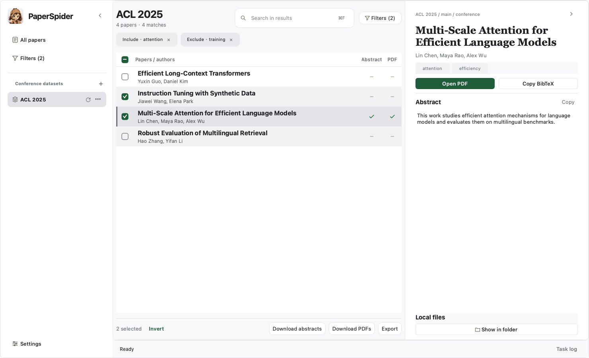

<h1 align="center">PaperSpider</h1>

<p align="center">
  
</p>

[中文 README](README.zh.md) · [English guide](docs/en.md) · [中文使用说明](docs/zh.md)

PaperSpider is a desktop app for finding conference papers, narrowing a large paper list, and downloading or exporting the results you need.



## What it does

- Fetches paper lists from major AI, systems, security, vision, and NLP conferences.
- Combines reusable filter rules with a quick search for further narrowing.
- Downloads abstracts and PDFs for one paper or many selected papers.
- Exports selected paper metadata and abstracts as CSV, JSON, or a plain list.
- Stores each conference and year locally in SQLite, alongside downloaded files.
- Follows the system light or dark appearance, or uses a fixed light or dark theme.
- Follows the system language, with Chinese and English interface text.

## Start

Download the latest package for **macOS** or **Windows** from
[GitHub Releases](https://github.com/isaacveg/PaperSpider/releases/latest).

To run from source, install [uv](https://docs.astral.sh/uv/), then run:

```bash
uv run paperspider
```

## Command-line interface

`paperspider-cli` exposes the same library without starting a server:

```bash
uv run paperspider-cli --help
uv run paperspider-cli datasets
uv run paperspider-cli add neurips 2024
uv run paperspider-cli search --conf neurips --year 2024 --query diffusion
uv run paperspider-cli show neurips 2024 PAPER_ID --fetch --bibtex
uv run paperspider-cli download-abstracts neurips 2024 PAPER_ID
uv run paperspider-cli download-pdfs neurips 2024 PAPER_ID
uv run paperspider-cli download-bibtex neurips 2024 PAPER_ID
uv run paperspider-cli export neurips 2024 --format bibtex --save
```

The CLI uses `PAPERSPIDER_BASE_DIR`, then the folder saved in the desktop app
settings, then `~/PaperSpider`; `--base-dir` overrides it. Use `--json` for
machine-readable output. Set `--delay-ms` or
`PAPERSPIDER_REQUEST_DELAY_MS` to pace web requests (0–10000 ms).
The complete manual is [man/paperspider-cli.1](man/paperspider-cli.1):

```bash
man ./man/paperspider-cli.1
# or add it to your user man path:
mkdir -p ~/.local/share/man/man1
install -m 644 man/paperspider-cli.1 ~/.local/share/man/man1/
man paperspider-cli
```

The desktop bundle does not include the CLI; run it from the Python package.

## Basic workflow

1. Pick a conference dataset from the left sidebar, or click **+** to add and fetch one. The refresh button updates the selected dataset; **⋯** opens its folder or deletes it.
2. Open **Filters** to add Include, Prefer, or Exclude rules; applied rules appear as chips under the search box.
3. Use **Search in results** to narrow the current filtered list further.
4. Select papers, then use the action bar to download abstracts or PDFs. Select one row for details and its individual actions.
5. Use **Export** for metadata; use **Copy BibTeX** in the details panel for BibTeX, fetching it when needed.

See the [English guide](docs/en.md) for filter meanings and the complete workflow.

## Supported conferences

NeurIPS, ICML, ICLR, AAAI, IJCAI, CVPR, ICCV, EMNLP, ACL, NAACL, SIGCOMM, NSDI, OSDI, ATC, FAST, USENIX Security, NDSS, and VLDB.

## Test

```bash
uv run python -m unittest discover -s tests -v
```

Apache-2.0. See [LICENSE](LICENSE) and [NOTICE](NOTICE).
