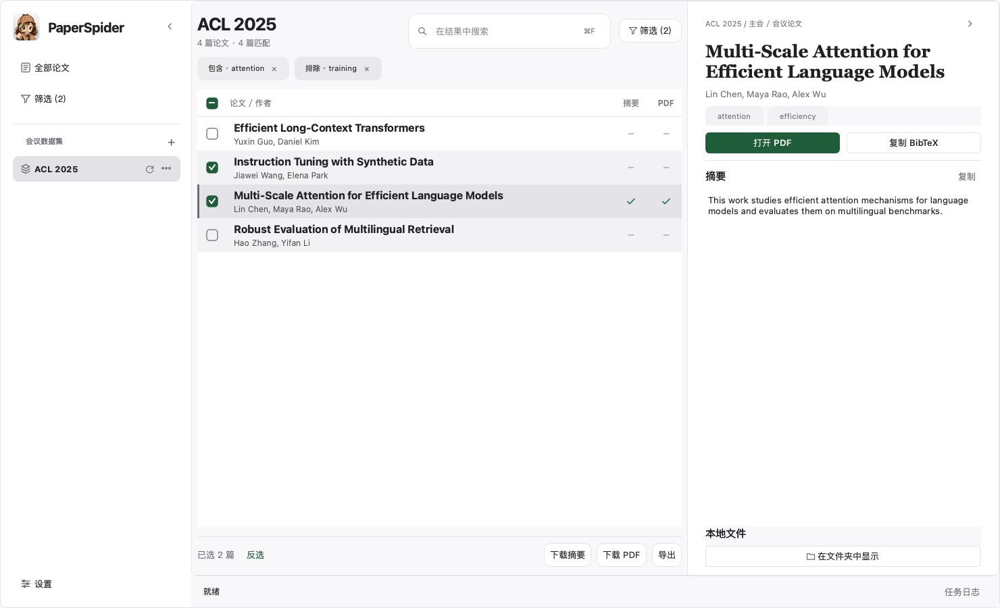

<h1 align="center">PaperSpider</h1>

<p align="center">
  
</p>

[English README](README.md) · [中文使用说明](docs/zh.md) · [English guide](docs/en.md)

PaperSpider 是一个会议论文桌面工具，用来获取论文列表、快速缩小范围，并批量下载或导出需要的论文信息。



## 主要用途

- 获取 AI、系统、安全、视觉和 NLP 领域主要会议的论文列表。
- 组合可复用的筛选规则，并用快速搜索进一步缩小结果。
- 下载单篇或批量下载论文摘要和 PDF。
- 将选中论文的元数据与摘要导出为 CSV、JSON 或纯文本列表。
- 按会议和年份将数据保存在本地 SQLite，并管理下载文件。
- 跟随系统浅色/深色外观，也可固定为 Light 或 Dark 主题。
- 跟随系统语言，提供中文和英文界面文案。

## 启动

可以从 [GitHub Releases](https://github.com/isaacveg/PaperSpider/releases/latest)
直接下载最新的 **macOS** 或 **Windows** 版本。

如需从源码运行，安装 [uv](https://docs.astral.sh/uv/) 后执行：

```bash
uv run paperspider
```

## 命令行

`paperspider-cli` 无需启动服务器，直接复用同一份本地论文库：

```bash
uv run paperspider-cli --help
uv run paperspider-cli datasets
uv run paperspider-cli add neurips 2024
uv run paperspider-cli search --conf neurips --year 2024 --query diffusion
uv run paperspider-cli show neurips 2024 PAPER_ID --fetch --bibtex
uv run paperspider-cli download-abstracts neurips 2024 PAPER_ID
uv run paperspider-cli download-pdfs neurips 2024 PAPER_ID
uv run paperspider-cli download-bibtex neurips 2024 PAPER_ID
uv run paperspider-cli export neurips 2024 --format bibtex --save
```

数据目录依次读取 `PAPERSPIDER_BASE_DIR`、桌面应用保存的目录，最后回退到
`~/PaperSpider`；可用 `--base-dir` 覆盖。`--json` 输出便于脚本处理的 JSON。
可用 `--delay-ms` 或 `PAPERSPIDER_REQUEST_DELAY_MS` 设置网络请求间隔（0–10000 毫秒）。
完整手册见 [man/paperspider-cli.1](man/paperspider-cli.1)：

```bash
man ./man/paperspider-cli.1
# 或安装到用户 man 路径：
mkdir -p ~/.local/share/man/man1
install -m 644 man/paperspider-cli.1 ~/.local/share/man/man1/
man paperspider-cli
```

桌面安装包不包含命令行工具，请从 Python 包运行。

## 基本流程

1. 在左侧边栏选择会议数据集，或点击 **+** 添加并抓取新数据集；刷新按钮用于更新选中数据集，选中后可用 **⋯** 打开文件夹或删除。
2. 打开 **筛选**，添加包含、偏好或排除规则；生效规则会显示在搜索框下方的 chips 中。
3. 使用 **在结果中搜索** 进一步缩小当前筛选结果。
4. 勾选论文后，用底部操作栏批量下载摘要或 PDF；选中单行可在右侧查看详情和单篇操作。
5. 使用 **导出** 导出元数据；在右侧详情中点击 **复制 BibTeX** 获取 BibTeX，缺失时会自动抓取。

筛选规则含义和完整操作见[中文使用说明](docs/zh.md)。

## 支持的会议

NeurIPS、ICML、ICLR、AAAI、IJCAI、CVPR、ICCV、EMNLP、ACL、NAACL、SIGCOMM、NSDI、OSDI、ATC、FAST、USENIX Security、NDSS 和 VLDB。

## 测试

```bash
uv run python -m unittest discover -s tests -v
```

本项目采用 Apache-2.0 许可证，详见 [LICENSE](LICENSE) 与 [NOTICE](NOTICE)。
